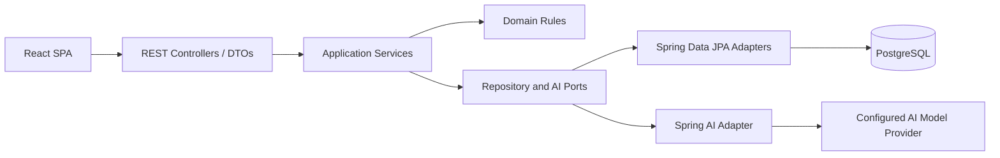
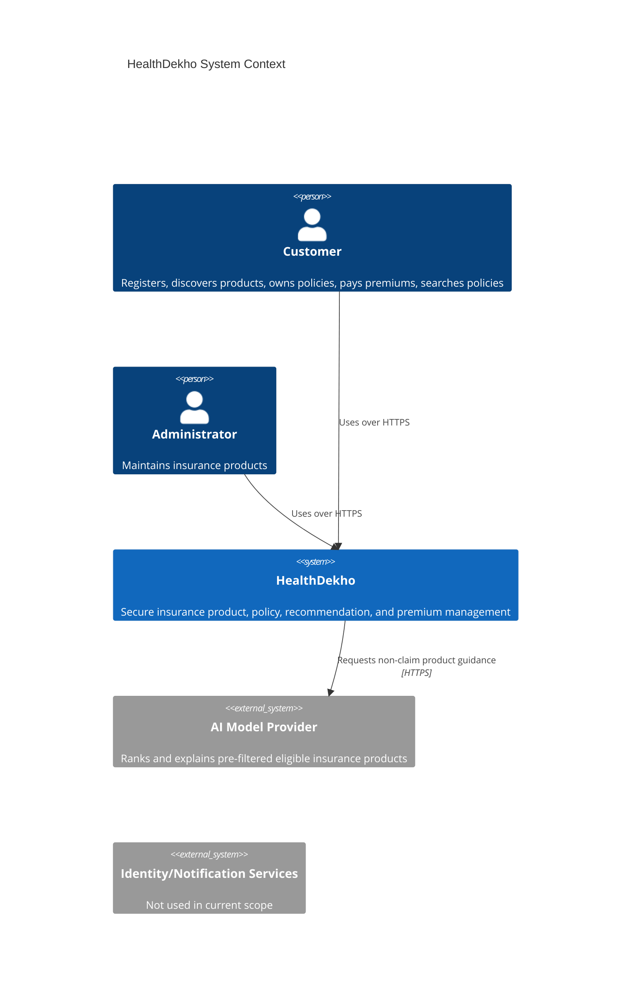
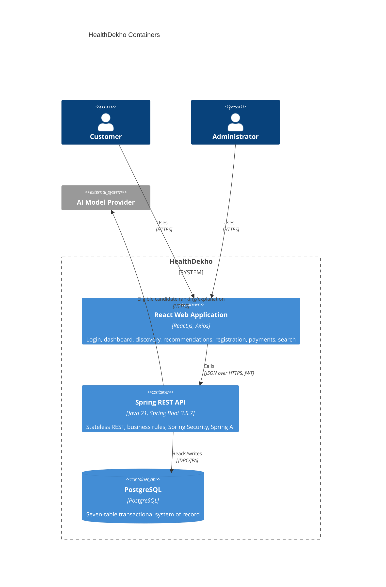
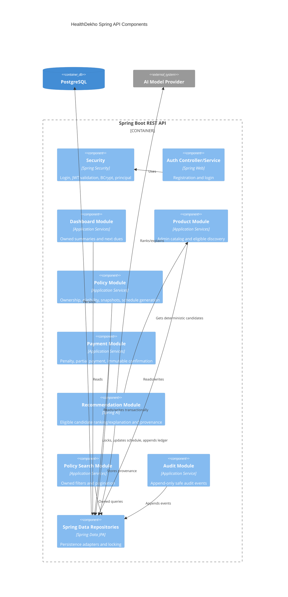
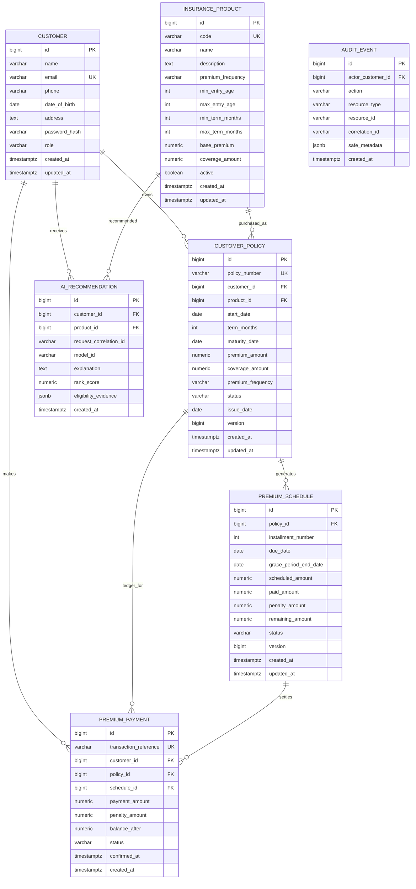
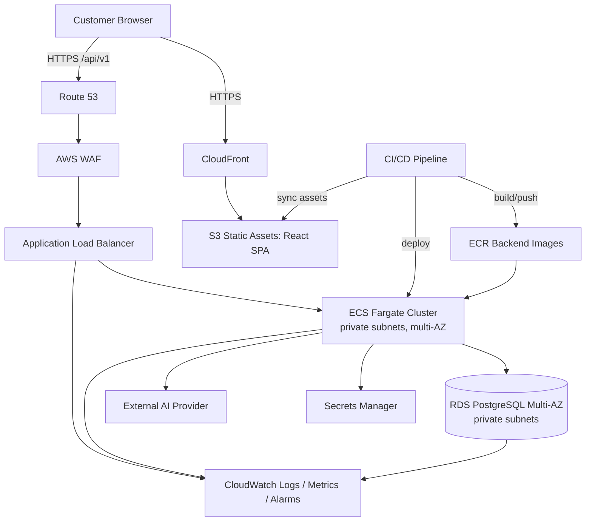

# Architecture: HealthDekho Insurance Management System

## 1. Design paradigm

HealthDekho is a **modular layered monolith**. A React.js SPA consumes a versioned Spring Web REST API. The backend keeps authentication, product discovery, policies, premium schedules/payments, AI product recommendations, and audit in independently testable modules while sharing one ACID PostgreSQL database.

Dependency direction is inward: REST controllers depend on application services; services depend on domain rules and repository ports/adapters; Spring Data JPA owns persistence integration; React depends only on REST contracts, never backend entities or database structure.



## 2. Invariants and architectural decisions

### AD-1 — Mandatory stack and split [ADOPTED]

- **Binds:** all capabilities
- **Prevents:** backend/frontend/database drift and forbidden substitutions
- **Rule:** Backend uses Java 21, Spring Boot 3.5.7, Spring Web, Spring Security, Spring Data JPA, PostgreSQL, Spring AI, and Bean Validation. Frontend uses React.js and Axios.

### AD-2 — JWT stateless security [ADOPTED]

- **Binds:** FR-1 and all protected endpoints
- **Prevents:** stateful-session coupling and cross-customer access
- **Rule:** `/api/v1/auth/login` verifies email/password, issues a signed short-lived JWT, and subsequent requests authenticate through a Spring Security JWT filter. Password hashes use BCrypt. Controllers/services derive customer ID only from the principal. Client identifiers may identify requested owned resources but never select ownership identity.

### AD-3 — Strict ownership and least privilege [ADOPTED]

- **Binds:** dashboard, policy, schedule, payment, search, recommendation
- **Prevents:** IDOR and customer data leakage
- **Rule:** Customer queries are constrained by authenticated customer ID. Missing, foreign, or forbidden records use ownership-neutral 403/404 behavior consistently. Product administration requires `ADMIN`.

### AD-4 — Seven-table authoritative model [ADOPTED]

- **Binds:** all persistence
- **Prevents:** unsupported schema expansion and claim scope leakage
- **Rule:** Current domain schema is exactly `customer`, `insurance_product`, `customer_policy`, `premium_schedule`, `premium_payment`, `ai_recommendation`, and `audit_event`. No claim/claim-history table or entity is created.

### AD-5 — Policy uniqueness and snapshots [ADOPTED]

- **Binds:** FR-2, FR-3
- **Prevents:** duplicate registrations and mutable historical policy economics
- **Rule:** PostgreSQL enforces `UNIQUE(customer_id, product_id)`. Registration snapshots premium, coverage, frequency, term, and eligibility evidence into `customer_policy`; subsequent product changes do not mutate existing policies.

### AD-6 — Calendar schedule generation [ADOPTED]

- **Binds:** FR-3, FR-4
- **Prevents:** inconsistent installment counts and date arithmetic
- **Rule:** Schedules are generated transactionally at registration from `start_date` in frequency increments (`MONTHLY=+1`, `QUARTERLY=+3`, `YEARLY=+12`) until the term boundary. `grace_period_end_date = due_date.plusDays(15)` and `maturity_date = start_date.plusMonths(term_months)`.

### AD-7 — Money is `BigDecimal` [ADOPTED]

- **Binds:** policy, payment, recommendation display data
- **Prevents:** binary floating-point drift
- **Rule:** Domain/API/JSON money contracts use decimal text or validated decimal DTOs mapped to `BigDecimal`; PostgreSQL uses `NUMERIC(19,2)`; calculations use scale 2 and `RoundingMode.HALF_UP`. Floating-point money is prohibited.

### AD-8 — Late fee and partial payments [ADOPTED]

- **Binds:** FR-4
- **Prevents:** inconsistent payment balances
- **Rule:** After grace end, mandatory penalty is `scheduled_amount * 0.10`. It is assessed once for the schedule and stored on `premium_payment.penalty_amount`. A valid partial payment leaves a positive remaining balance and `PARTIALLY_PAID`; overpayment beyond remaining balance plus applicable penalty is rejected. Schedule and ledger updates occur in one transaction with locking/optimistic-version protection.

### AD-9 — Immutable payment ledger [ADOPTED]

- **Binds:** FR-4 and audit requirements
- **Prevents:** destructive correction and unverifiable balances
- **Rule:** Confirmed simulated payments append `premium_payment` rows with unique `TXN-HD-XXXXXX` references. Application repositories expose no update/delete operations; database privilege/trigger controls block ordinary mutation. Corrections append a ledger/audit record.

### AD-10 — Deterministic eligibility before AI [ADOPTED]

- **Binds:** FR-2, FR-5
- **Prevents:** AI bypassing policy and age rules
- **Rule:** Candidate selection is deterministic first: active, not held by the customer, and product age range contains authenticated customer age. Spring AI may only rank/explain this bounded candidate set. AI output is untrusted text, escaped in React, and never contains claims functionality.

### AD-11 — Policy terminal/payment state [ADOPTED]

- **Binds:** FR-3, FR-4
- **Prevents:** contradictory policy status ownership
- **Rule:** `customer_policy.status` uses `ACTIVE`, `PAID`, `MATURED`, `CANCELLED`. It becomes `PAID` only when all schedules are `PAID`. A scheduled maturity/status job may mark eligible mature policies `MATURED`; user-facing maturity transitions cannot corrupt a paid balance. Cancellation is administrative and disallows new payments.

### AD-12 — FE-1 absence [ADOPTED]

- **Binds:** UI, API, domain, database, stories, deployment
- **Prevents:** claim scope creep
- **Rule:** No claim entity, DTO, controller, route, migration/table, service, screen, story, or prompt is implemented. AI product recommendations are unrelated to claim assessment.

### AD-13 — REST contracts and error envelope [ADOPTED]

- **Binds:** all API consumers
- **Prevents:** incompatible response/error interpretation
- **Rule:** APIs are under `/api/v1`, use JSON and ISO-8601 dates. Validation, auth, ownership, conflict, and server errors use one `ApiError` shape with stable `code`, `message`, `correlationId`, optional `fieldErrors`, and no sensitive details.

### AD-14 — AWS production topology [ADOPTED]

- **Binds:** production deployment and operations
- **Prevents:** local-only assumptions and single-instance dependencies
- **Rule:** ALB terminates client HTTPS and routes to private ECS Fargate tasks across multiple Availability Zones. RDS PostgreSQL Multi-AZ remains private; ECS receives database/AI secrets through Secrets Manager. CloudWatch receives structured logs and metrics. SPA assets are served from S3 behind CloudFront in the recommended split-origin variant.

## 3. Consistency conventions

| Concern | Convention |
|---|---|
| API base/version | `/api/v1/**`; additive compatibility within v1; breaking changes require v2 |
| Error shape | `{code,message,correlationId,fieldErrors?,timestamp,path}` |
| IDs | PostgreSQL bigint internally; opaque references/policy numbers/transactions externally as applicable |
| Dates | ISO-8601 `yyyy-MM-dd`; timestamps ISO-8601 UTC |
| Money | Decimal JSON strings or numeric values consumed through decimal-safe DTO mapping; never `float`/`double` |
| Naming | Java camelCase; database snake_case; REST kebab-style or resource nouns consistently |
| Authentication | `Authorization: Bearer <JWT>`; access token has subject, roles, issued/expiry claims; no password/token logging |
| State mutation | Commands through transactional application services; JPA repositories are not invoked from controllers or React |
| Audit | Security and material domain events append `audit_event` with actor/correlation/resource and safe metadata |
| AI | Bounded candidates passed to Spring AI; prompt/output version stored; deterministic fallback on provider failure |
| Configuration | Environment variables/Secrets Manager; no committed production credentials |
| Pagination | `page,size,sort` with a bounded maximum page size |

## 4. C4 context diagram



## 5. C4 container diagram



## 6. C4 component diagram



## 7. PostgreSQL data model (seven tables)



**Cross-table invariants**

- `UNIQUE(customer_id, product_id)` on `customer_policy`.
- `premium_schedule` unique on `(policy_id, installment_number)`.
- Schedule status and amounts cannot be negative; `remaining_amount = scheduled + applicable penalty - paid` under domain invariant.
- `premium_payment` and `audit_event` are append-only from the application's perspective.
- `ai_recommendation` stores only eligible product guidance and never references claims.
- Currency is not modeled as a separate currency table; one two-decimal monetary convention applies until the assessment owner changes the contract.

## 8. REST API contracts

### Common transport

- Base: `/api/v1`
- Content type: `application/json`
- Protected requests: `Authorization: Bearer <JWT>`
- Dates: `yyyy-MM-dd`; amounts: two-decimal decimal values
- Page parameters: `page`, `size` (max 100), `sort`
- Error example:

```json
{
  "code": "VALIDATION_FAILED",
  "message": "One or more fields are invalid.",
  "correlationId": "4fd4e8...",
  "fieldErrors": {"termMonths": "Must be between 12 and 60."},
  "timestamp": "2026-11-25T10:30:00Z",
  "path": "/api/v1/policies"
}
```

### Authentication and profile

| Method | Path | Role | Request | Response |
|---|---|---|---|---|
| POST | `/api/v1/auth/register` | Public | `{name,email,phone,dateOfBirth,address,password}` | `201 CustomerProfile` |
| POST | `/api/v1/auth/login` | Public | `{email,password}` | `200 {accessToken,tokenType,expiresIn}` |
| GET | `/api/v1/me` | Customer/Admin | — | `200 CustomerProfile` |
| PATCH | `/api/v1/me` | Customer/Admin | `{name,phone,address}` | `200 CustomerProfile` |

### Dashboard, products, recommendations

| Method | Path | Role | Request/query | Response |
|---|---|---|---|---|
| GET | `/api/v1/dashboard` | Customer | — | owned policy count, statuses, amount due, next due, recent ledger |
| GET | `/api/v1/products` | Customer | `page,size,eligibleOnly=true` | eligible active/not-held/age-matched product page |
| GET | `/api/v1/products/{productId}` | Customer | — | eligible public product detail |
| POST | `/api/v1/admin/products` | Admin | product DTO | `201 Product` |
| PUT | `/api/v1/admin/products/{productId}` | Admin | product DTO | `200 Product` |
| POST | `/api/v1/admin/products/{productId}/deactivate` | Admin | — | `200 Product` |
| POST | `/api/v1/recommendations` | Customer | `{maxItems}` | `200 RecommendationResult[]` |
| GET | `/api/v1/recommendations` | Customer | page/size | customer's recommendation provenance |

Recommendation result:

```json
{
  "productId": 12,
  "productName": "Health Essential",
  "explanation": "Non-binding product guidance based on eligible product facts.",
  "eligibility": {"active": true, "ageEligible": true, "notAlreadyRegistered": true},
  "disclaimer": "This is guidance, not insurance advice or claim assessment."
}
```

### Policies and search

| Method | Path | Role | Request/query | Response |
|---|---|---|---|---|
| POST | `/api/v1/policies` | Customer | `{productId,startDate,termMonths}` | `201 PolicyDetail` |
| GET | `/api/v1/policies` | Customer | `query,status,productId,startFrom,startTo,page,size,sort` | owned `PolicySummary[]` |
| GET | `/api/v1/policies/{policyId}` | Customer | — | owned `PolicyDetail` with schedule summaries |
| POST | `/api/v1/admin/policies/{policyId}/cancel` | Admin | `{reason}` | `200 PolicySummary` |

Registration transaction: eligibility → duplicate check → immutable snapshot → unique policy number → schedule generation → audit event.

### Premium schedules, payments, and ledger

| Method | Path | Role | Request/query | Response |
|---|---|---|---|---|
| GET | `/api/v1/policies/{policyId}/schedules` | Customer | optional `status` | owned schedule list |
| POST | `/api/v1/policies/{policyId}/schedules/{scheduleId}/payments` | Customer | `{amount}` | `201 PaymentConfirmation` |
| GET | `/api/v1/payments` | Customer | `policyId,scheduleId,page,size` | owned immutable ledger |
| GET | `/api/v1/payments/{transactionReference}` | Customer | — | owned ledger detail |

Payment confirmation:

```json
{
  "transactionReference": "TXN-HD-8F31C2",
  "status": "CONFIRMED",
  "paymentAmount": "500.00",
  "penaltyAmount": "0.00",
  "balanceAfter": "1000.00",
  "scheduleStatus": "PARTIALLY_PAID",
  "policyStatus": "ACTIVE"
}
```

## 9. Security architecture

1. Spring Security stateless chain ignores security on registration/login only; all business endpoints require JWT.
2. Access token verification checks signature, issuer/audience if configured, expiry, and roles. Logout clears client token; server revocation is deferred unless assessment requires it.
3. BCrypt uses a configured strength suitable for assessment runtime and stores only the hash.
4. CORS allows the known React origin(s), with explicit methods/headers rather than wildcard credentials.
5. CSRF is not relied on as the primary control for a bearer-token API; JWT is not placed in a cookie for v1.
6. Security headers are set at ALB/application as applicable; secrets never enter source control or logs.
7. Bean Validation protects DTO boundaries; domain/service/database constraints remain authoritative.

## 10. Transaction and concurrency strategy

### Policy registration

- One transaction: load product/customer, compute age/term eligibility, check duplicate, lock/create policy, snapshot values, generate all schedules, append audit.
- Unique constraint is final race protection; `DataIntegrityViolationException` maps to `POLICY_ALREADY_EXISTS`.

### Payment

- One transaction with optimistic version or pessimistic lock on `premium_schedule` and relevant policy.
- Calculate penalty once from current date and schedule; validate amount against remaining payable amount.
- Append `premium_payment`, update schedule balances/status, recompute whether all schedules are paid, transition policy to `PAID` only if true, append audit, commit atomically.
- The immediate simulator returns only the committed ledger confirmation; connection ambiguity is resolved by retry-safe transaction reference lookup rather than resubmitting blindly.

## 11. AWS production topology



### AWS rules

- Public ALB receives only intended HTTPS traffic; ECS and RDS have no public inbound path.
- ECS runs at least two tasks across Availability Zones for production availability.
- RDS PostgreSQL Multi-AZ is required for failover; backups, encryption, minor-upgrade policy, and PITR retention are deployment configuration.
- CloudWatch captures structured JSON logs, ECS/ALB/RDS metrics, 4xx/5xx/latency/error alarms, and database CPU/storage alarms.
- Secrets Manager stores DB and AI provider credentials; ECS task role permits only required reads.
- CloudFront/S3 serves React separately; ALB serves `/api/v1/**`.
- The production deployment does not move AI claims into scope; only bounded product recommendation requests cross the provider boundary.

## 12. Testing strategy

- Unit: age eligibility, term, date/schedule, maturity, 15-day grace, 10% penalty, partial/overpayment, status transitions, recommendation candidate filtering.
- Repository/integration: unique customer/product, schedule uniqueness, append-only controls, locking behavior, JPA mappings, PostgreSQL date/decimal behavior.
- API/security: JWT required, invalid/expired token, role denial, IDOR/ownership, Bean Validation, error redaction.
- Contract: Axios-facing DTOs and error schema, including absent claim routes.
- Frontend: login, dashboard, empty/error states, recommendation fallback, registration conflict, payment boundary/overpayment, owned search, keyboard behavior.
- End-to-end: US-01 through US-07 against ephemeral PostgreSQL and controlled AI adapter.

## 13. Capability-to-architecture map

| Capability | Primary component | Governed by |
|---|---|---|
| AUTH / registration / login | Security + Auth module | AD-1, 2, 3, 7, 13 |
| DASH | Dashboard module | AD-2, 3, 7, 13 |
| DISC | Product module | AD-3, 5, 10, 12, 13 |
| AI | Recommendation module | AD-10, 12 |
| REG | Policy module | AD-5, 6, 7, 11 |
| PAY | Payment module | AD-6, 7, 8, 9, 11 |
| SEA | Search module | AD-3, 13 |

## 14. Deferred decisions

- JWT signing key rotation cadence, exact expiry, and issuer/audience values: deployment configuration, with secure rotation required.
- AI model/provider, prompt template, and ranking threshold: external provider choice; interface and deterministic fallback are fixed.
- Currency symbol and locale: display configuration only; decimal semantics are fixed.
- Cloud region, account boundaries, retention duration, exact autoscaling thresholds, and RDS instance class: environment sizing after capstone/non-production review.
- Cancellation permissions/workflow details: administrative API is seeded; exact authorization/operational review remains implementation policy and cannot affect FE-1 scope.

## 15. Architecture approval checklist

- [x] Mandatory stack preserved.
- [x] JWT stateless authentication at `/api/v1/auth/login`.
- [x] Strict JWT-derived customer isolation.
- [x] Exactly seven PostgreSQL tables and ER diagram.
- [x] Policy statuses and payment-state semantics fixed.
- [x] 15-day grace, 10% late penalty, partial payment, overpayment rejection.
- [x] Immutable `premium_payment` ledger and `TXN-HD-XXXXXX` references.
- [x] Product AI bounded by deterministic eligibility.
- [x] FE-1 absent from DB/API/UI/domain.
- [x] C4 context/container/component views.
- [x] REST contracts and error envelope.
- [x] AWS ALB, ECS Fargate, RDS Multi-AZ, CloudWatch topology.
- [ ] Human approval required before application code.
