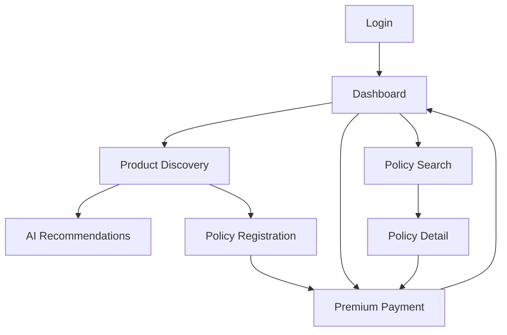
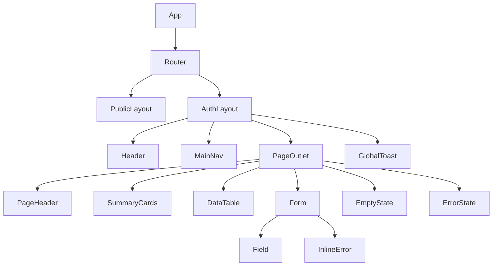

# HealthDekho UX Design Specification

## 1. Foundation

HealthDekho is a responsive React.js web application served separately from a Spring REST API. Axios is the only browser API client. JWT is stored in memory for the assessment baseline and attached as `Authorization: Bearer <token>` after login; a refresh-token mechanism is not in scope. UX copy treats recommendations as non-binding product guidance and never references claims.

### Design principles

1. **Trust through transparency:** show eligibility, calculation basis, due date, grace end, penalty, and remaining balance before mutation.
2. **Ownership by default:** customer screens show only JWT-owned records.
3. **Progressive disclosure:** primary action and essential numbers first; details in structured sections.
4. **Recoverable errors:** preserve valid form input and focus the first failing field.
5. **Assessment scope:** no claim navigation, claim component, AI adjudication copy, or unrelated feature.

## 2. Information architecture



### Navigation

- Public: Login
- Authenticated desktop/tablet: Dashboard, Discover Products, Recommendations, My Policies, Premiums
- Authenticated mobile: compact top bar plus bottom or collapsible primary navigation; persistent labels and icons
- Account menu: profile identity and logout

## 3. Global component hierarchy



### Shared components

- `AppShell`: authenticated navigation, user identity, skip link, responsive outlet.
- `PageHeader`: title, short context, primary action.
- `SummaryCard`: label, amount/count, status, optional helper text.
- `PolicyCard`: product, policy number, status, next due, maturity, amount action.
- `ProductCard`: name, frequency, premium, coverage, age eligibility, recommendation explanation, register action.
- `StatusBadge`: semantic text plus color; never color-only.
- `DataTable`: sortable headings, mobile card fallback, pagination if required.
- `MoneySummary`: scheduled, paid, penalty, remaining values using server-provided amounts.
- `FormField`: label, hint, required marker, inline error, described-by linkage.
- `EmptyState`: clear cause plus one permitted next action.
- `ErrorState`: safe summary, retry where meaningful, preserved page context.
- `ConfirmDialog`: totals and irreversible action confirmation; focus trap and return focus.
- `ToastRegion`: polite live region for non-blocking outcomes.
- `LoadingSkeleton`: stable layout with accessible busy status.

## 4. Responsive behavior

- **Mobile, < 640 px:** single column; cards instead of wide tables; bottom/collapsible navigation; primary actions full-width; dialog becomes full-width sheet.
- **Tablet, 640–1023 px:** two-column summary grid; product/policy cards in two columns where content fits; filters collapsible.
- **Desktop, ≥ 1024 px:** 240 px app navigation or top navigation with bounded 1440 px content; three-column card grids; table and filter rail.
- Content reflows to 320 CSS px with no horizontal page scrolling except the table's isolated scroll region when unavoidable.
- User-supplied long names, policy numbers, errors, and AI explanations wrap without clipping.

## 5. Screen specifications and wireframes

### 5.1 Login

**Flow:** Public entry → email/password → submit → JWT → Dashboard. Unauthorized expiry returns to Login with “Your session expired” and preserves no password.

```text
┌─────────────────────────────────────────┐
│ HealthDekho        Secure customer login│
│                                         │
│  Email                                  │
│  [_______________________________]      │
│  Password                               │
│  [_______________________________] [◎]  │
│  [ Sign in                            ] │
│                                         │
│  Inline form / service error            │
└─────────────────────────────────────────┘
```

- Label all fields; support password reveal; disable submit while pending.
- 401 is shown as a generic invalid-credentials message.
- 400/422 shows field-level validation; 5xx shows retryable service error.
- Registration is linked only if the assessment requires a customer registration screen; it is part of US-01 even if routed separately.

### 5.2 Dashboard

**Purpose:** owned policy and payment overview after authentication.

```text
┌ Header: Welcome, Aisha        Account ┐
├ Navigation ──────────────────────────┤
│ Summary: Active │ Due now │ Next due │
│                                          │
│ Next payment ─ amount/grace/status [Pay] │
│ My policies ─ cards                      │
│ Recent payment ledger                     │
└──────────────────────────────────────────┘
```

- Summary cards query server-provided owned aggregates.
- Empty: no policies → “No policies yet” and Discover Products CTA.
- Error: preserve shell; section-level retry rather than blanking all content.
- Loading: stable card skeletons and accessible `aria-busy`.

### 5.3 Product Discovery

**Flow:** Authenticated Dashboard/navigation → request active eligible not-held products → filter/sort → inspect card → register or request recommendations.

```text
┌ Discover products              [Filters] ┐
│ [ Product result 1 ] [ Product result 2 ] │
│ Name / premium / frequency                 │
│ Coverage / eligible age / term             │
│ [View details] [Register]                  │
└────────────────────────────────────────────┘
```

- API must return only active, age-matched, not-already-registered products for registration actions.
- Ineligible/duplicate products are absent rather than presented with a client-only disabled state.
- Empty: “No new eligible products” with link to My Policies.

### 5.4 AI Recommendations

**Flow:** User opens recommendations → server deterministically filters candidates → Spring AI ranks/explains those candidates → response renders disclosures → user opens a recommended product or registers.

```text
┌ Recommendations                         │
│ “Guidance only; eligibility is verified │
│ separately.”                             │
│                                          │
│ 1. Product — Why suggested               │
│    eligibility facts / price / coverage  │
│    [View product]                        │
└──────────────────────────────────────────┘
```

- AI output is untrusted display text; render it escaped, never as HTML.
- Recommendation API never returns an ineligible, inactive, or already-held product.
- If AI provider is unavailable, fallback to deterministic eligibility cards without an AI explanation and show non-blocking degradation copy.
- No claim topic, claim text field, or claim action is accepted or generated.

### 5.5 Policy Registration

**Flow:** Eligible Product → details/financial snapshot → start date and term → review calculated maturity and schedules → confirm → immutable policy snapshot + generated schedule → Policy Detail.

```text
┌ Register: Health Essential        Step 1 │
│ Product facts                            │
│ Start date [________]                    │
│ Term months [________]                   │
│                                          │
│ Review: premium, coverage, maturity      │
│ [Back] [Confirm registration]             │
└──────────────────────────────────────────┘
```

- Repeat submission is prevented by pending state and server idempotency/conflict response.
- Show duplicate conflict as “You already hold this product” without exposing other records.
- Confirmation dialog repeats product, term, premium, coverage, start, and maturity.
- 409 and server validation preserve form inputs.

### 5.6 Premium Payment

**Flow:** Dashboard/Policy → schedule list → select payable installment → review scheduled, prior paid, penalty, remaining → enter payment amount → immediate simulated confirmation → refreshed ledger and balances.

```text
┌ Payment — Policy HD...                  │
│ Due 01 Jan    Grace ended 16 Jan        │
│ Scheduled 1500.00                        │
│ Already paid 0.00                       │
│ 10% penalty 150.00                      │
│ Remaining 1650.00                       │
│ Amount [________]                        │
│ [Confirm simulated payment]              │
│ Transaction: TXN-HD-XXXXXX               │
└──────────────────────────────────────────┘
```

- Penalty is shown separately and cannot be silently hidden in scheduled amount.
- Client cannot calculate authoritative totals; server response drives final display.
- Partial payment success states `PARTIALLY_PAID`; full settlement states `PAID`.
- Overpayment validation prevents confirmation and server independently rejects it.
- Refresh after success, not duplicated optimistically.
- Empty: no payable installments → status explanation, no enabled Pay action.

### 5.7 Policy Search

**Flow:** My Policies → text/status/date/product filters → own-policy result list → detail.

```text
┌ My policies                              │
│ Search [________] Status [All ▾] [Clear] │
│ Product / policy / dates / status / next │
│ [View]                                    │
└──────────────────────────────────────────┘
```

- Search is strictly customer-scoped by JWT.
- Empty query results: explain filters and offer Clear filters.
- Status values: `ACTIVE`, `PAID`, `MATURED`, `CANCELLED`.
- No raw customer identifier filter is exposed.

## 6. State patterns

| State | Standard behavior |
|---|---|
| Initial load | Stable skeleton, no shifted action controls |
| Empty | Specific empty copy, one relevant action, no vague illustration-only state |
| Validation error | Inline field message; summary; focus first invalid field; preserve valid values |
| Unauthorized 401 | Clear local JWT; safe session-expired message; redirect to Login |
| Forbidden 403 | “You do not have access to this resource”; never reveal object existence |
| Not found 404 | Ownership-neutral “Resource not found” where disclosure matters |
| Conflict 409 | Explain duplicate/state conflict and next allowed action |
| Network timeout | “Connection interrupted”; do not claim payment failed or succeeded without transaction lookup |
| Server error 5xx | Safe message and retry when operation is idempotent or read-only |
| Payment pending | Disable duplicate action; use operation/correlation ID |
| AI unavailable | Deterministic eligible-product fallback; label AI explanation unavailable |

## 7. Voice and tone

- Clear, concise, financial, and non-promissory.
- Never imply insurance recommendation is binding advice.
- Use “Register policy” consistently; avoid “buy now” urgency.
- Use “Simulated payment confirmed” in the assessment interface.
- Show transaction reference and amounts using server-normalized two-decimal values.
- Do not use claims terminology anywhere in current UX.

## 8. Accessibility standards

- Target WCAG 2.2 AA for the assessment interface.
- Keyboard: visible focus, logical order, no positive `tabindex`, skip link, focus restoration, Escape-close dialogs, and trapped modal focus.
- Screen readers: semantic headings/landmarks, labelled controls, programmatic table headers, status text, live regions for async outcomes, and error associations.
- Color: never sole means of communicating status; minimum 4.5:1 normal text, 3:1 large text and UI boundaries.
- Motion: no required animation; honor `prefers-reduced-motion`.
- Touch: controls target at least 44×44 CSS px.
- Forms: autocomplete where safe, explicit labels, required/invalid states, no password exposure by default.
- Responsive: 200% zoom without loss of content or operation; 320 px reflow where practical.

## 9. UX acceptance checks

- UX-1: Login and registration flow completes JWT auth and handles 400/401/5xx states.
- UX-2: Dashboard surfaces owned summaries, next premium, and recoverable empty/error states.
- UX-3: Product discovery presents only active, age-eligible, not-held products.
- UX-4: AI recommendation is labelled non-binding, candidate-validated, escaped, and degrades gracefully.
- UX-5: Policy registration shows calculation review and handles duplicates without data loss.
- UX-6: Payment visibly separates schedule, penalty, amount, and remaining balance; partial/overpayment behavior is testable.
- UX-7: Policy search is JWT-owned and provides no cross-customer identifier path.
- UX-8: All screens reflow, are keyboard operable, and communicate errors/states without color alone.
