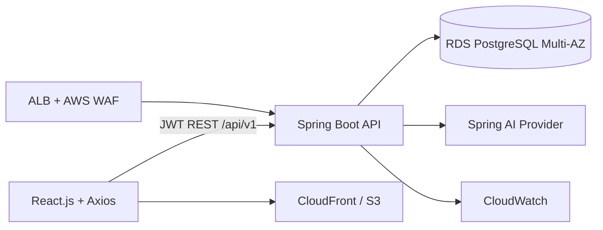
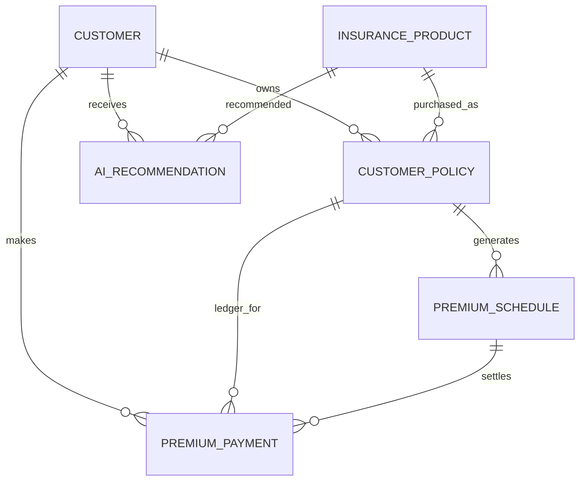

# HealthDekho Architecture

The authoritative architecture artifact is [`../_bmad-output/architecture.md`](../_bmad-output/architecture.md). It defines the approved architecture spine, C4 diagrams, seven-table PostgreSQL ER model, REST contracts, ADRs, security model, transaction strategy, and AWS production topology.

## Architecture summary

- **Paradigm:** modular layered monolith plus React SPA
- **Backend:** Java 21, Spring Boot 3.5.7, Spring Web/Security/Data JPA/AI, Bean Validation
- **Frontend:** React.js and Axios
- **System of record:** PostgreSQL with exactly seven tables
- **Authentication:** stateless JWT from `POST /api/v1/auth/login`; BCrypt passwords; strict JWT-derived ownership
- **AI scope:** Spring AI ranks/explains only deterministic eligible insurance products; FE-1 claims are absent
- **Payments:** 15-day grace, 10% post-grace penalty on scheduled amount, partial payments, overpayment rejection, immutable ledger
- **Production:** ALB, private multi-AZ ECS Fargate, RDS PostgreSQL Multi-AZ, Secrets Manager, CloudWatch; React assets from S3/CloudFront

For complete diagrams, ADR rules, table columns, and endpoint request/response contracts, use the authoritative file. **No application code may be generated until the architecture is human-approved.**
